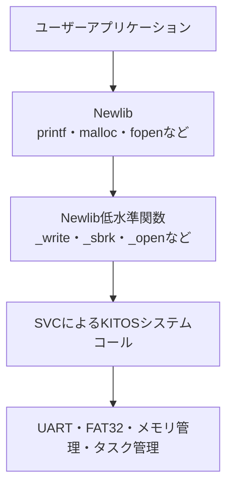
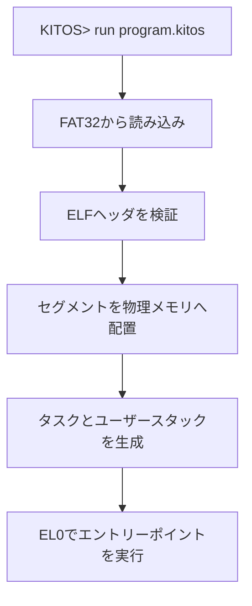

# KITOS（キートス）

Raspberry Pi 4 Model B向けに開発した，AArch64ベアメタル環境で動作する教育用DOSライクOSです．

## プロジェクトの状態

**2026年10月時点で，卒業研究として予定していた基本機能の実装を完了し，本プロジェクトの機能開発を一区切りとしました．**

UARTによる対話操作，割込み，プリエンプティブなタスク切り替え，FAT32の読み書き，シェル，テキストエディタ，Tiny BASIC，GPIO入出力，アプリケーションごとのメモリセクション配置を実装しています．今後の卒業研究では，動作検証の結果と設計・実装内容を整理し，論文としてまとめます．

ここでの「完成」は，卒業研究で定めた実装範囲を完了したことを意味します．汎用OSとして必要な機能をすべて備えたことや，不具合が存在しないことを意味するものではありません．

EL0ユーザーモード，SVCによるシステムコール，Newlib，ELFローダ，仮想メモリは，この完成範囲には含めません．

今後これらの機能を実装する場合は，KITOSからフォークした別プロジェクト「**Enhanced KITOS**」として開発を進める構想です．KITOSは卒業研究の成果を示す実装として位置付け，Enhanced KITOSでは，その設計とソースコードを引き継いで機能の拡張を目指します．

## 概要

KITOSは，現代的なコンピュータ上で動作する，小規模で理解しやすいDOSライクOSを設計・実装するプロジェクトです．大学の卒業研究として開発しました．

本プロジェクト以前にも，`KIT-OS`（2026年4月〜5月）という名称で自作OSを開発していました．当時は，初めて汎用OSを開発する段階でありながら，次の機能を同時に実現しようとしていました．

- x86_64／UEFIとAArch64への対応
- 仮想メモリ
- 独自ファイルシステム
- 複数アーキテクチャで共通利用できるカーネル
- 高機能な汎用OSとしての構成

しかし，設計規模が急速に大きくなり，各機能を十分に理解・開発・検証できないまま開発が停滞しました．その反省から，現在のKITOSでは対象をRaspberry Pi 4 Model BとAArch64に絞り，基本機能を段階的に実装しました．

OSを構成する各機能の関係を追跡でき，ソースコードと設計を自分自身で説明できる規模に収めることを重視しています．

## 目的

次の機能を実際に設計・実装し，ハードウェアからアプリケーションまでの動作を理解することを目的としています．

- AArch64ベアメタル環境での起動とBSS初期化
- UARTによる対話的な文字入出力
- GPIOによる外部機器との入出力
- 例外，GIC，タイマ割込みの処理
- コンテキストスイッチとタスクスケジューリング
- FAT32ファイルシステムの読み書き
- コマンドラインシェル
- アプリケーションごとのコード・データ・スタックの配置

## DOSライクについて

KITOSにおける「DOSライク」とは，シリアル端末での文字入力と文字表示を中心とする，単純なコマンドライン環境を意味します．

MS-DOSとのAPI互換性や，既存のMS-DOS用バイナリの実行は目的としていません．MS-DOSや初期UNIXを参考に，OS内部の処理を把握しやすい構成を目指しました．

## 対象環境

| 項目 | 内容 |
| --- | --- |
| 対象機種 | Raspberry Pi 4 Model B |
| CPUアーキテクチャ | ARM64／AArch64 |
| 主な実装言語 | C，AArch64アセンブリ |
| 実行環境 | ベアメタル |
| ストレージ | SDカード |
| ファイルシステム | FAT32 |
| 入出力 | UART／シリアル端末，GPIO |
| 検証環境 | Raspberry Pi 4B，QEMU |
| カーネルイメージ | `kernel8.img` |
| クロスコンパイラ | `aarch64-elf-gcc` |

実機では，Raspberry Piのファームウェアから`kernel8.img`を起動します．U-Bootなどの追加ブートローダーには依存しません．

## 実装状況

| 分類 | 機能 | 状況 |
| --- | --- | --- |
| 起動 | AArch64カーネルの起動，BSS初期化 | 実装済み |
| 入出力 | UARTによる文字入出力 | 実装済み |
| 入出力 | GPIOの入力・出力モード設定，読み取り，書き込み | 実装済み |
| 例外・割込み | 例外ベクタ，GICv2制御，タイマ割込み | 実装済み |
| タスク | ARM64コンテキストスイッチ，複数タスクの実行 | 実装済み |
| タスク | ラウンドロビン方式，タイマによるプリエンプション | 実装済み |
| タスク | スリープ／時限待ち，停止・再開・終了の操作 | 実装済み |
| ストレージ | SDカードアクセス | 実装済み |
| ファイルシステム | FAT32読み書き，ファイル作成・保存，ディレクトリ操作 | 実装済み |
| シェル | 対話型コマンドライン | 実装済み |
| アプリケーション | テキストエディタ，Tiny BASIC，GPIO操作 | 実装済み |
| メモリ配置 | アプリごとのtext・rodata・data・bss・スタック配置 | 実装済み |
| 同期 | セマフォ | Enhanced KITOSでの拡張候補 |
| ユーザーモード | EL0でのプログラム実行 | Enhanced KITOSでの拡張候補 |
| システムコール | SVCによるEL0からEL1への呼び出し | Enhanced KITOSでの拡張候補 |
| 標準ライブラリ | Newlib移植 | Enhanced KITOSでの拡張候補 |
| 実行形式 | ELFローダ | Enhanced KITOSでの拡張候補 |
| 仮想メモリ | ページング，アドレス空間分離 | Enhanced KITOSでの拡張候補 |

「実装済み」は開発環境で動作を確認した機能を示します．実機とQEMUで，すべての周辺機器が同等に動作することを保証するものではありません．

## シェル

起動後はシリアル端末からコマンドを入力します．以下では，現在のディレクトリを含む`KITOS:/>`形式で操作例を示します．表示文字列は使用する版によって異なる場合があります．

UART通信には，実機のRaspberry Pi 4BではPL011 UARTを使用しています．一方，開発に使用したQEMU環境ではPL011 UARTを利用できなかったため，mini UARTドライバを実装し，QEMU環境でのシリアル入出力に使用しています．

```text
KITOS:/> help
help | echo TEXT | clear | ps | uart
sleep ID N[s|ms] (positive integer; default: seconds)
run demo_a|demo_b|demo_sleep
stop ID | resume ID | kill ID | color ID COLOR
Colors: default red green yellow blue magenta cyan white


KITOS:/> echo HelloWorld!!
HelloWorld!!
KITOS:/> pwd
/

KITOS:/> run demo_a
Started demo_a: id=2
        (A_A)
        (A_A)
        (A_A)
KITOS:/> ps
ID  NAME      STATE     WORK         COLOR     STACK_AREA                    SIZE
1   shell     RUNNING   0            default   [0x870ba0 <- 0x880000] 62560 bytes
2   demo_a    READY     2458827      default   [0x800040 <- 0x810000] 65472 bytes
        (A_A)
        (A_A)
KITOS:/> kill 2
OK: kill 2

KITOS:/> ls
d 0  test
- 13  HELLO.txt
- 124  GPIO_TEST.BAS
- 159  SWITCH_LED.BAS

KITOS:/> uart
irq=366 rx=366 drop=0 overrun=0

KITOS:/> mkdir test
KITOS:/> cd test
KITOS:/test> touch test.BAS
KITOS:/test> editor
```

| コマンド | 概要 |
| --- | --- |
| `help` | 使用可能なコマンドを表示する |
| `echo` | 文字列を表示する |
| `clear` | 画面をクリアする |
| `pwd` | 現在のディレクトリを表示する |
| `ls` | ファイルとディレクトリを一覧表示する |
| `cd` | 現在のディレクトリを変更する |
| `mkdir` | ディレクトリを作成する |
| `touch` | 空のファイルを作成する |
| `editor` | テキストエディタを起動する |
| `basic` | Tiny BASICを起動する |
| `gpio` | GPIOの設定，入力，出力を操作する |
| `run` | 登録済みの組み込みタスクを起動する |
| `ps` | タスクの状態，スタック領域，確保容量などを表示する |
| `sleep` | 指定したタスクを一定時間スリープさせる |
| `stop`／`resume` | タスクを停止／再開する |
| `kill` | タスクを終了させる |
| `color` | タスクの表示色を変更する |
| `uart` | UART受信の統計情報を表示する |

正確な引数と利用できるコマンドは，その版の`help`表示を参照してください．

## テキストエディタとTiny BASIC

UART端末上で動作する簡易テキストエディタを実装しています．KITOS内でBASICのソースファイルを編集し，FAT32上へ保存できます．

| 操作 | 内容 |
| --- | --- |
| 矢印キー | カーソルを移動する |
| `Ctrl+S` | ファイルを保存する |
| `Ctrl+X` | エディタを終了する |

保存するプログラムの例：

```basic
10 PRINT "hello kitos!!"
20 END
```

Tiny BASICからファイルを読み込み，実行できます．

```text
BASIC> LOAD test.BAS
Loaded
BASIC> RUN
hello kitos!!
```

変数は整数型の`A`から`Z`までを基本としています．`LOAD`，`RUN`，`HELP`のほか，GPIO制御とタイマーを利用する機能を組み込み，簡単な外部機器の制御をKITOS上のプログラムから試せる構成としています．詳細な構文はBASIC内の`HELP`を参照してください．

## GPIO

GPIOドライバの抽象化関数を通じて，シェルとBASICから入出力を操作できます．実機では，LEDの出力制御とスイッチの入力を確認しています．

GPIOコマンドには，40ピンヘッダの物理ピン番号ではなく，**BCM GPIO番号**を指定します．

```text
KITOS:/> gpio 17 out
KITOS:/> gpio 17 1
KITOS:/> gpio 17 0
KITOS:/> gpio 18 in
KITOS:/> gpio 18
```

| 指定 | 内容 |
| --- | --- |
| `gpio <pin> out` | 出力モードへ設定する |
| `gpio <pin> in` | 入力モードへ設定する |
| `gpio <pin> 1`／`high` | HIGHを出力する |
| `gpio <pin> 0`／`low` | LOWを出力する |
| `gpio <pin>` | ピンの入力値を読み取る |

出力値を書き込む前に，対象ピンを出力モードに設定します．UARTなどで使用中のピンを変更すると，その機能の動作に影響します．

外部回路の動作確認にはRaspberry Pi 4B実機を使用します．QEMU上でコマンドを実行できることと，実際のLEDやスイッチを制御できることは，別の評価項目です．

## タスク管理

タイマ割込みを利用したラウンドロビン方式で，複数のタスクを切り替えます．コンテキストスイッチでは，タスクの実行再開に必要なCPU状態を保存・復元します．

```text
KITOS:/> run demo_a
KITOS:/> run demo_b
KITOS:/> ps
KITOS:/> sleep 2 3000ms
KITOS:/> stop 2
KITOS:/> resume 2
KITOS:/> kill 2
```

上記の`2`は操作対象のタスクIDの例です．実際のIDは起動時の表示または`ps`で確認してください．

`sleep ID N`は秒を基本とし，`3s`や`3000ms`の指定にも対応します．待機中のタスクを実行対象から外し，指定時間の経過後に再び実行可能にします．

`ps`ではタスクの状態とスタックのアドレス範囲・確保容量を確認できます．表示される容量は予約されたスタック領域の大きさであり，現在のスタック使用量ではありません．

## メモリセクションの分割

リンカスクリプトでカーネルと各アプリケーションの配置を定め，アプリケーションごとに固定の物理メモリ領域を設けています．

各アプリケーションのオブジェクトファイルから，次のセクションを取り出して配置します．

以下の表は，次のコマンドで取得したセクション情報を基にまとめたものです．

```bash
aarch64-elf-objdump -h build/arm64/kernel8.elf 
```

アドレス範囲は開始アドレス以上，終了アドレス未満を表します．

| セクション | 領域 | 用途 |
| --- | --- | --- |
| `reset` | 0x00080000 ～ 0x00080090 | 起動時の初期化コード |
| `vector_table` | 0x00080800 ～ 0x00081000 | 例外・割込みベクターテーブルの配置 |
| `text` | 0x00081000 ～ 0x0008A608 | カーネルの実行する機械語コード |
| `rodata` | 0x0008A610 ～ 0x0008B2D8 | カーネルの文字列や定数などの読み取り専用データ |
| `data` | 0x0008B2D8 ～ 0x0008B740 | カーネルの初期値を持つグローバル変数・静的変数 |
| `bss` | 0x0008B740 ～ 0x000FE280 | カーネルのゼロ初期化するグローバル変数・静的変数 |
| `stack` | 0x000FE280 ～ 0x0010E280（64 KiB） | カーネルの関数呼び出しや自動変数，実行状態の保存に使う領域 |
| `demo_a_text` | 0x00800000 ～ 0x00800040 | demo_aの実行する機械語コード |
| `demo_a_bss` | 0x00800040（0バイト） | demo_aのゼロ初期化データ用セクション（領域の割当なし） |
| `demo_a_stack` | 0x00800040 ～ 0x00810000 | demo_aの関数呼び出しや自動変数，実行状態の保存に使う領域 |
| `demo_b_text` | 0x00810000 ～ 0x00810040 | demo_bの実行する機械語コード |
| `demo_b_bss` | 0x00810040（0バイト） | demo_bのゼロ初期化データ用セクション（領域の割当なし） |
| `demo_b_stack` | 0x00810040 ～ 0x00820000 | demo_bの関数呼び出しや自動変数，実行状態の保存に使う領域 |
| `demo_c_text` | 0x00820000 ～ 0x00820040 | demo_cの実行する機械語コード |
| `demo_c_bss` | 0x00820040（0バイト） | demo_cのゼロ初期化データ用セクション（領域の割当なし） |
| `demo_c_stack` | 0x00820040 ～ 0x00830000 | demo_cの関数呼び出しや自動変数，実行状態の保存に使う領域 |
| `demo_d_text` | 0x00830000 ～ 0x00830040 | demo_dの実行する機械語コード |
| `demo_d_bss` | 0x00830040（0バイト） | demo_dのゼロ初期化データ用セクション（領域の割当なし） |
| `demo_d_stack` | 0x00830040 ～ 0x00840000 | demo_dの関数呼び出しや自動変数，実行状態の保存に使う領域 |
| `basic_text` | 0x00840000 ～ 0x0084242C | BASICの実行する機械語コード |
| `basic_rodata` | 0x00842430 ～ 0x00842C54 | BASICの文字列や定数などの読み取り専用データ |
| `basic_bss` | 0x00842C58 ～ 0x00842C90 | BASICのゼロ初期化するグローバル変数・静的変数 |
| `basic_stack` | 0x00842C90 ～ 0x00850000 | BASICの関数呼び出しや自動変数，実行状態の保存に使う領域 |
| `editor_text` | 0x00850000 ～ 0x00851CD0 | エディタの実行する機械語コード |
| `editor_rodata` | 0x00851CD0 ～ 0x008520BB | エディタの文字列や定数などの読み取り専用データ |
| `editor_bss` | 0x008520BB ～ 0x008520C0 | エディタのゼロ初期化するグローバル変数・静的変数 |
| `editor_stack` | 0x008520C0 ～ 0x00860000 | エディタの関数呼び出しや自動変数，実行状態の保存に使う領域 |
| `gpio_text` | 0x00860000 ～ 0x008605A0 | GPIOアプリの実行する機械語コード |
| `gpio_rodata` | 0x008605A0 ～ 0x00860734 | GPIOアプリの文字列や定数などの読み取り専用データ |
| `gpio_bss` | 0x00860734 ～ 0x00860740 | GPIOアプリのゼロ初期化するグローバル変数・静的変数 |
| `gpio_stack` | 0x00860740 ～ 0x00870000 | GPIOアプリの関数呼び出しや自動変数，実行状態の保存に使う領域 |
| `shell_text` | 0x00870000 ～ 0x00870630 | シェルの実行する機械語コード |
| `shell_rodata` | 0x00870630 ～ 0x008706E8 | シェルの文字列や定数などの読み取り専用データ |
| `shell_bss` | 0x008706F0 ～ 0x00870BA0 | シェルのゼロ初期化するグローバル変数・静的変数 |
| `shell_stack` | 0x00870BA0 ～ 0x00880000 | シェルの関数呼び出しや自動変数，実行状態の保存に使う領域 |

対象には，`demo_a`〜`demo_d`，Tiny BASIC，エディタ，GPIOアプリケーション，シェルを含みます．アプリケーション用のコード・データをカーネル用セクションから分け，各領域の開始・終了アドレスをリンカシンボルで参照できるようにしています．

この設計により，アプリケーションの配置とスタックの範囲をソースコードおよび`ps`の表示から追跡できます．固定配置を採用した理由は，動的なローダや仮想記憶を導入する前に，コード・データ・スタックとタスク実行の関係を明確にするためです．

**この分割は，MMUによるメモリ保護やプロセスごとのアドレス空間分離ではありません．** 同じ物理アドレス空間内の配置を整理しているため，不正なポインタやスタックの範囲外アクセスによって他の領域を破壊する可能性は残ります．

また，アプリケーションは現在もカーネルと一緒にリンクされます．領域を分けたことによって，SDカード上の独立した実行ファイルを読み込めるようになるわけではありません．同じアプリケーションの複数同時起動に必要なデータ・スタックの分離も，この配置だけでは保証しません．

## ファイルシステム

SDカードを介してホストPCとファイルを交換できるよう，FAT32を採用しています．以下の機能を実装しています．

 - FAT32ボリュームの認識
 - ディレクトリエントリの読み込みとパス解決
 - ファイルの読み込み・書き込み・作成
 - ディレクトリの作成と一覧取得
 - エディタでの保存とBASICからの読み込み

SDカードへのアクセスには，実機のRaspberry Pi 4BではeMMC2コントローラを使用しています．一方，開発に使用したQEMU環境ではeMMC2を利用できなかったため，QEMU側のSDホストコントローラに対応するSDHCIドライバを実装しています．

電源断や異常終了時の完全な整合性は保証していません．重要なデータを保存したSDカードやディスクイメージは使用しないでください．

## 開発環境と実機での動作確認

### 使用機材

実機での動作確認には，以下のハードウェアを使用します．GPIOの入出力を確認する場合は，ブレッドボードや電子部品，ジャンパー線も必要です．

- Raspberry Pi 4B
- SDカード
- USB–UART変換アダプタ（本検証ではSH-U09Cを使用）
- ブレッドボード
- LED，電流制限抵抗，タクトスイッチなどの電子部品
- ジャンパー線

本検証では，私物の機材・部品を使用しました．ホストPCとのシリアル通信にはUSB–UART変換アダプタを使用し，Raspberry Pi 4BのUART端子とホストPCのUSBポートを接続しています．

### シリアル通信による操作

ホストPCで`screen`を使用すると，KITOSのシリアル出力の確認とキーボードによる入力ができます．通信速度は115200 bpsです．以下の手順では，`screen`がインストールされていることを前提とします．

#### Linux

USB–UART変換アダプタを接続し，デバイス名を確認します．

```sh
ls /dev/ttyUSB*
```

デバイス名が`/dev/ttyUSB0`の場合，以下のコマンドで接続します．デバイス名が異なる場合は，実際の名前に置き換えてください．

```sh
screen /dev/ttyUSB0 115200
```

アクセス権限のエラーが発生する場合は，以下のように実行します．

```sh
sudo screen /dev/ttyUSB0 115200
```

#### WSL 2

WSL 2では，USB–UART変換アダプタをWindows側からWSLへ接続する必要があります．`usbipd-win`を導入し，WSLを起動したうえで，WindowsのPowerShellから対象デバイスのBUSIDを確認します．

```powershell
usbipd list
```

管理者権限のPowerShellで，対象デバイスの共有を設定します．以下の`<BUSID>`は，確認した値に置き換えてください．

```powershell
usbipd bind --busid <BUSID>
```

続いて，PowerShellからWSLへ接続します．

```powershell
usbipd attach --wsl --busid <BUSID>
```

接続後は，WSL内でデバイス名を確認します．

```sh
ls /dev/ttyUSB*
```

デバイス名が`/dev/ttyUSB0`の場合，以下のコマンドで接続します．

```sh
screen /dev/ttyUSB0 115200
```

アクセス権限のエラーが発生する場合は，Linuxと同様に`sudo`を付けて実行します．

#### macOS

USB–UART変換アダプタを接続し，デバイス名を確認します．

```sh
ls /dev/cu.usbserial*
```

本検証で使用したSH-U09Cでは，以下のコマンドで接続します．デバイス名は環境や個体によって異なるため，実際の名前に置き換えてください．

```sh
screen /dev/cu.usbserial-BG03182R 115200
```

#### 接続の終了

いずれの環境でも，`screen`を終了するには，`Ctrl+A`を押してから`K`を押し，確認に対して`Y`を入力します．

## QEMU 10.2.2のインストール

KITOSで動作確認したQEMUのバージョンは **10.2.2** です．以下では公式ソースからAArch64システムエミュレータをビルドし，`$HOME/qemu-10.2.2`へインストールします．パッケージ管理ツールのQEMUは配布時期によってバージョンが変わるため，ここでは版を固定しています．

QEMUをビルドするホスト用コンパイラと，KITOSをビルドする`aarch64-elf-gcc`は別のツールです．以下の手順はQEMUの導入用であり，KITOSのクロスコンパイラは別途必要です．

### Ubuntu／Debian系Linux

以下はUbuntu／Debian系の例です．その他のLinuxでは，同等の開発パッケージを使用するディストリビューションのパッケージ管理ツールで導入してください．

#### 1. ビルドに必要なパッケージ

```sh
sudo apt update
sudo apt install -y \
  build-essential curl xz-utils pkg-config \
  python3 python3-venv python3-pip \
  meson ninja-build \
  libglib2.0-dev libpixman-1-dev libfdt-dev zlib1g-dev
```

#### 2. ソースの取得とビルド

```sh
mkdir -p "$HOME/src"
cd "$HOME/src"
curl -fLO https://download.qemu.org/qemu-10.2.2.tar.xz
tar -xf qemu-10.2.2.tar.xz
cd qemu-10.2.2
mkdir -p build
cd build

../configure \
  --python=/usr/bin/python3 \
  --target-list=aarch64-softmmu \
  --prefix="$HOME/qemu-10.2.2" \
  --disable-docs

make -j"$(nproc)"
make install
```

各段階が成功したことを確認してから次へ進みます．ホームディレクトリにインストールするため，`make install`に`sudo`は不要です．`--disable-docs`はQEMU自身のドキュメント生成を省略する指定です．

#### 3. 環境変数PATHへの登録（Bash）

環境変数`PATH`には，コマンドを検索するディレクトリを登録します．次の設定を`~/.bashrc`へ追加することで，新しいターミナルでも使用できます．

```sh
touch "$HOME/.bashrc"
if ! grep -Fqx 'export PATH="$HOME/qemu-10.2.2/bin:$PATH"' "$HOME/.bashrc"; then
  printf '%s\n' 'export PATH="$HOME/qemu-10.2.2/bin:$PATH"' >> "$HOME/.bashrc"
fi
source "$HOME/.bashrc"
hash -r
```

先頭へ追加するため，別のQEMUがインストールされていても，この版を優先します．Zshを使うLinux環境では，登録先を`~/.zshrc`に変更してください．

### Windows（WSL2／Ubuntu）

Windowsでは，WSL2上のUbuntuでLinux向け手順を実行します．このREADMEではWindowsネイティブ版QEMUの導入は扱いません．

WSLを導入していない場合は，管理者として開いたPowerShellで実行します．

```powershell
wsl --install -d Ubuntu
```

再起動を求められた場合は再起動し，Ubuntuの初回起動でユーザー名とパスワードを設定します．PowerShellで状態を確認できます．

```powershell
wsl --list --verbose
```

Ubuntuの`VERSION`が`2`であることを確認します．以降のパッケージ導入・ソース取得・ビルド・PATH登録は，**Ubuntuのターミナル内で「Ubuntu／Debian系Linux」の手順を実行**してください．

QEMUとKITOSのビルド・実行はWSL内で行います．PATHはUbuntu側の`~/.bashrc`へ登録し，Windowsの環境変数へLinux用QEMUのパスを追加する必要はありません．

### macOS（Apple Silicon／Intel）

#### 1. Command Line ToolsとClang

QEMUのソースビルドには，Mac上で実行するプログラムを作るためのCコンパイラが必要です．AppleのCommand Line Toolsに含まれるClangを使用します．

未導入の場合は次を実行し，表示されるダイアログからインストールを完了させます．Xcodeなどにより既に使用できる場合は再インストール不要です．

```sh
xcode-select --install
```

導入後に確認します．

```sh
xcode-select -p
xcrun --find clang
clang --version
```

このClangはQEMUのホスト用ビルドに使用します．KITOS用の`aarch64-elf-gcc`の代わりではありません．通常，QEMUのために`brew install llvm`で別のClangを追加する必要はありません．

#### 2. Homebrewと依存パッケージ

Homebrewが未導入の場合は，[Homebrew公式サイト](https://brew.sh/)の手順で導入します．インストール完了時に表示される「Next steps」に従って，Homebrew自身もPATHに登録してください．

既に導入済みの場合は，次で確認できます．

```sh
brew --version
```

QEMUのビルドに必要なパッケージを導入します．

```sh
brew update
brew install python pkgconf glib pixman ninja meson
```

#### 3. ソースの取得とビルド

```sh
mkdir -p "$HOME/src"
cd "$HOME/src"
curl -fLO https://download.qemu.org/qemu-10.2.2.tar.xz
tar -xf qemu-10.2.2.tar.xz
cd qemu-10.2.2
mkdir -p build
cd build

../configure \
  --cc="$(xcrun --find clang)" \
  --python="$(brew --prefix)/bin/python3" \
  --target-list=aarch64-softmmu \
  --prefix="$HOME/qemu-10.2.2" \
  --disable-docs

make -j"$(sysctl -n hw.ncpu)"
make install
```

各段階が成功したことを確認してから次へ進みます．Apple SiliconとIntelのHomebrew配置の違いは，`brew --prefix`で取得します．ホームディレクトリにインストールするため，`sudo`は不要です．

#### 4. 環境変数PATHへの登録（Zsh）

macOSの標準シェルであるZshでは，`~/.zshrc`へ設定を追加します．

```sh
touch "$HOME/.zshrc"
if ! grep -Fqx 'export PATH="$HOME/qemu-10.2.2/bin:$PATH"' "$HOME/.zshrc"; then
  printf '%s\n' 'export PATH="$HOME/qemu-10.2.2/bin:$PATH"' >> "$HOME/.zshrc"
fi
source "$HOME/.zshrc"
rehash
```

Bashを使用している場合は，LinuxのBash向けPATH登録手順を使用してください．macOSのログインBashでも読み込ませるには，`~/.bash_profile`から`~/.bashrc`を読み込む設定が必要です．

### インストール結果の確認（共通）

```sh
command -v qemu-system-aarch64
qemu-system-aarch64 --version
qemu-system-aarch64 -machine help
```

次を確認します．

- コマンドのパスが，ホームディレクトリ内の`qemu-10.2.2/bin/qemu-system-aarch64`を指している
- バージョンが`10.2.2`である
- マシン一覧に`raspi4b`が含まれる

PATHを使わず，絶対パスに相当する指定で確認することもできます．

```sh
"$HOME/qemu-10.2.2/bin/qemu-system-aarch64" --version
```

新しいターミナルでも実行できることを確認してください．VS Codeの統合ターミナルで反映されない場合は，ターミナルを作り直します．

別のQEMUが選ばれる場合は`type -a qemu-system-aarch64`で候補を確認します．既存版を削除せずにPATHの順序で切り替えられます．

これらは過去の導入記録と公式資料をもとに整理した手順です．新規のUbuntu・WSL・macOS環境で，このREADMEの手順全体を再実行した検証は行っていません．

参考：[QEMU公式ソース配布](https://download.qemu.org/)，[QEMU 10.2系のビルド環境](https://qemu.readthedocs.io/en/stable-10.2/devel/build-environment.html)，[Apple Command Line Tools](https://developer.apple.com/documentation/xcode/installing-the-command-line-tools/)，[WSLのインストール](https://learn.microsoft.com/windows/wsl/install)．

## SDカードとsd.imgの準備

KITOSはMBR形式のディスク上にあるFAT32パーティションを使用します．実機用SDカードとQEMU用イメージの容量は一致させる必要がありません．配布・検証用には，数十GB以上のイメージではなく，**全体1 GiB，BOOT約256 MiB，DOSDATAは残り**の構成を例とします．

| パーティション | 形式 | 用途 |
| --- | --- | --- |
| 第1：BOOT | FAT32 | 実機起動用ファームウェア，設定，カーネル |
| 第2：DOSDATA | FAT32 | KITOSから読み書きするファイル |

**実機SDのフォーマットは既存データをすべて消去します．** デバイス名は接続のたびに変わるため，例の番号をそのまま使用せず，容量・機種を確認してください．以下のディスク操作は，QEMUとKITOSを停止してから行います．

### QEMU用sd.img：Ubuntu／Debian・WSL2

リポジトリのルートで実行します．必要なツールを導入します．

```sh
sudo apt install -y util-linux fdisk dosfstools
```

既存の`image/arm64/sd.img`がある場合は，先に別名へ退避してください．次は新規ファイルだけを作成します．

```sh
mkdir -p image/arm64
python3 - <<'PY'
from pathlib import Path
p = Path("image/arm64/sd.img")
with p.open("xb") as f:
    f.truncate(1024 * 1024 * 1024)
PY
```

上の作成が成功した場合だけ，次へ進みます．512バイトセクタ単位で，開始位置と容量を指定します．

```sh
sfdisk image/arm64/sd.img <<'PARTITIONS'
label: dos
unit: sectors

start=2048, size=524288, type=c
start=526336, size=1570816, type=c
PARTITIONS

sfdisk --dump image/arm64/sd.img
```

ループデバイスへ接続し，両パーティションを明示的にFAT32でフォーマットします．

```sh
kitos_loop=$(sudo losetup --find --show --partscan image/arm64/sd.img)
printf '%s\n' "$kitos_loop"
lsblk "$kitos_loop"
```

表示された対象が作成した1 GiBのイメージであり，`p1`と`p2`が存在することを確認してから実行します．

```sh
sudo mkfs.fat -F 32 -n BOOT "${kitos_loop}p1"
sudo mkfs.fat -F 32 -n DOSDATA "${kitos_loop}p2"
sync
sudo losetup --detach "$kitos_loop"
```

WSL2でループデバイスやパーティションの認識に失敗する場合は，その先のフォーマットを実行せず，WSLの更新または通常のLinux環境で作成してください．

この指定どおりに作成したイメージでは，第2パーティションの開始LBAは`526336`です．

### QEMU用sd.img：macOS

リポジトリのルートで，未使用の1 GiBイメージを作成します．既存の`sd.img`は先に退避してください．

```sh
mkdir -p image/arm64
python3 - <<'PY'
from pathlib import Path
p = Path("image/arm64/sd.img")
with p.open("xb") as f:
    f.truncate(1024 * 1024 * 1024)
PY
```

作成が成功した場合だけ，書き込み可能なRAWイメージとして接続します．

```sh
hdiutil attach -imagekey diskimage-class=CRawDiskImage \
  -nomount image/arm64/sd.img
```

出力されたディスク名を確認します．以下の`/dev/diskN`を，その**ディスクイメージ**の名前へ置き換えてください．

```sh
diskutil list /dev/diskN
diskutil partitionDisk /dev/diskN 2 MBRFormat \
  FAT32 BOOT 256MiB FAT32 DOSDATA R
diskutil list /dev/diskN
diskutil info /dev/diskNs2
```

フォーマットに成功し，両方がFAT32であることを確認します．第2パーティションの開始LBAは，次項の方法で実際の値を取得してください．macOSの配置がLinuxの例と同じになるとは限りません．

作業後は接続を解除します．

```sh
hdiutil detach /dev/diskN
```

### ファームウェアとデバイスツリーのダウンロード

Raspberry Pi公式の[raspberrypi/firmware](https://github.com/raspberrypi/firmware)から，各自で必要なファイルを取得してください．

| ファイル | 公式の配布ページ | 用途 |
| --- | --- | --- |
| `start4.elf` | [ダウンロード元](https://github.com/raspberrypi/firmware/blob/master/boot/start4.elf) | Raspberry Pi 4用ファームウェア |
| `fixup4.dat` | [ダウンロード元](https://github.com/raspberrypi/firmware/blob/master/boot/fixup4.dat) | `start4.elf`に対応する補助ファイル |
| `bcm2711-rpi-4-b.dtb` | [ダウンロード元](https://github.com/raspberrypi/firmware/blob/master/boot/bcm2711-rpi-4-b.dtb) | Raspberry Pi 4 Model Bのデバイスツリー |

ブラウザでは，リンク先の「Download raw file」などから**バイナリ本体**を保存してください．GitHubの表示ページを「ページを保存」で保存したHTMLは使用できません．

macOS・Linux・WSLでは，リポジトリのルートから次のコマンドで取得できます．保存先は`image/arm64/`です．同名ファイルがあれば上書きするため，必要な場合は先に退避してください．

```sh
mkdir -p image/arm64
curl -fL https://raw.githubusercontent.com/raspberrypi/firmware/master/boot/start4.elf \
  -o image/arm64/start4.elf
curl -fL https://raw.githubusercontent.com/raspberrypi/firmware/master/boot/fixup4.dat \
  -o image/arm64/fixup4.dat
curl -fL https://raw.githubusercontent.com/raspberrypi/firmware/master/boot/bcm2711-rpi-4-b.dtb \
  -o image/arm64/bcm2711-rpi-4-b.dtb
```

`start4.elf`と`fixup4.dat`は同じリポジトリの同じ版から取得します．`master`は更新されるため，再現性が必要な場合は，3つのURLの`master`を同じコミットIDへ置き換え，取得した版を記録してください．最新ファイルとの組み合わせは別途起動確認が必要です．

実機では，これらをSDカードの**BOOTパーティション直下**へ，`config.txt`とビルド済み`kernel8.img`と一緒にコピーします．`image/arm64/`にダウンロードしただけでは，実機SDへのコピーは行われません．

QEMUでは本READMEの起動コマンドが，DTBを`image/arm64/bcm2711-rpi-4-b.dtb`から読み込みます．`start4.elf`と`fixup4.dat`は，この`-kernel`による直接起動では使用しません．

配布元のライセンスは[LICENCE.broadcom](https://github.com/raspberrypi/firmware/blob/master/boot/LICENCE.broadcom)および[COPYING.linux](https://github.com/raspberrypi/firmware/blob/master/boot/COPYING.linux)を参照してください．

### 実機用SDカードのフォーマット

実機では1 GiB以上のSDカードを使用できます．128 GBなどの大容量カードを用意する必要はありません．

macOSでは，まず対象を確認します．

```sh
diskutil list
diskutil info /dev/diskN
```

容量と機種から対象SDカードを特定した後，そのカード全体をMBR・FAT32の2パーティションに作り直します．

```sh
diskutil partitionDisk /dev/diskN 2 MBRFormat \
  FAT32 BOOT 256MiB FAT32 DOSDATA R
```

Linuxではディスク管理GUIなどで，パーティションテーブルをMBR（DOS），第1を約256 MiBのFAT32，残りを第2のFAT32として作成します．FAT16やexFATではなくFAT32を指定してください．WSLで物理SDへのアクセスが使えない場合は，Windows側のパーティション管理ツールか，macOS／通常のLinuxで作業します．

BOOTへ，Raspberry Pi 4B用の`start4.elf`，`fixup4.dat`，必要なDTB，`config.txt`，再ビルドした`kernel8.img`を配置します．使用するファームウェア構成に必要な他のファイルも併せて配置してください．BASICソースなどKITOSから操作するファイルはDOSDATAへ配置します．

QEMUは既存の起動例では`-kernel`でカーネルを直接読み込むため，BOOTのファームウェアから起動する実機とは経路が異なります．

### 第2パーティションの開始LBAを確認する

Linuxでは次の`start=`を確認します．

```sh
sfdisk --dump image/arm64/sd.img
# 実機SDの場合は，対象を確認してから次の形式で読み取る
# sudo sfdisk --dump /dev/sdX
```

macOSでは，接続中のイメージまたはSDカードについて確認します．

```sh
diskutil info /dev/diskNs2
```

`Partition Offset`のバイト数を，ディスクの論理セクタサイズで割った値が開始LBAです．本手順は**512バイトセクタ**を前提にしています．例えば`269484032 Bytes`なら`269484032 / 512 = 526336`です．`diskutil list`の丸められた容量から推定しないでください．

512バイトセクタのMBRイメージでは，次の読み取り専用スクリプトでも各エントリの開始LBAを確認できます．

```sh
python3 - <<'PY'
import struct
with open("image/arm64/sd.img", "rb") as f:
    mbr = f.read(512)
if len(mbr) != 512 or mbr[510:512] != b"\x55\xaa":
    raise SystemExit("有効なMBRシグネチャがありません")
for i in range(4):
    e = mbr[446 + i * 16:462 + i * 16]
    start, size = struct.unpack_from("<II", e, 8)
    if e[4] and size:
        print(f"partition {i+1}: type=0x{e[4]:02x}, start LBA={start}, sectors={size}")
PY
```

MBRのエントリ番号，FAT32形式，期待したデータ領域であることを併せて確認します．

### include/dos/config.hの修正と再ビルド

現在は，データ領域の開始LBAを`include/dos/config.h`で指定します．次は開発者環境の値であり，作成したディスクへ無条件に流用する値ではありません．

```c
/* データ領域としてマウントするFAT32パーティション */
#define QEMU_DATA_PARTITION_LBA 62502912ULL
#define RPI4_DATA_PARTITION_LBA 67110912ULL
```

- `QEMU_DATA_PARTITION_LBA`：自分の`sd.img`の第2パーティションの開始LBA
- `RPI4_DATA_PARTITION_LBA`：自分の実機SDの第2パーティションの開始LBA

例えば，Linuxの上記手順どおりに作成したイメージなら次の設定です．

```c
#define QEMU_DATA_PARTITION_LBA 526336ULL
```

実機用の値は，実機SDで確認した値を別途設定します．両者が一致する必要はありません．単位はバイトではなくセクタであり，パーティションの容量でもありません．

変更後はカーネルを再ビルドします．

```sh
make clean
make
```

実機では新しい`kernel8.img`をBOOTへコピーし直します．QEMUではイメージの接続・マウントを解除してから`make run`で起動してください．パーティションを作り直した場合も，LBAの再確認と必要な再ビルドを行います．

起動後は`ls`や小さなテストファイルの作成・保存・再読み込みでDOSDATAの動作を確認します．LBAが違うまま書き込みを試すと別の領域を破壊するおそれがあるため，先に設定を照合してください．

上記手順は新規ディスク構成の例です．OS別のフォーマット操作をこの文書作成環境で実行した検証は行っていません．

## ビルド方法

### 必要なツール

- GNU Make
- AArch64ベアメタル向けGCC：`aarch64-elf-gcc`
- 同ツールチェーンのBinutils
- QEMUで実行する場合：`qemu-system-aarch64`（`raspi4b`対応）

使用するツールがPATHから実行できることを確認します．

```sh
aarch64-elf-gcc --version
aarch64-elf-objcopy --version
make --version
qemu-system-aarch64 --version
```

### カーネルのビルド

リポジトリのルートでMakefileを使用します．

```sh
make
```

カーネルイメージの出力先は`image/arm64/kernel8.img`です．QEMUでの起動には`make run`を使用します．

```sh
make run
```

> この説明は既存のビルド記録に基づきます．Makefile本体の最終版は未確認のため，`make`の既定ターゲットとSDイメージの生成方法は，使用する版のMakefileに合わせて確認してください．カーネルのビルドだけでSDイメージや実機用ファームウェアが自動生成されるとは限りません．

## 実行方法

### QEMU

基本的には，リポジトリのルートで次を実行します．

```sh
make run
```

QEMUを直接起動する場合の例です．カーネル，FAT32を含むSDカードイメージ，DTBをあらかじめ用意します．

```sh
qemu-system-aarch64 \
  -M raspi4b \
  -m 2g \
  -kernel image/arm64/kernel8.img \
  -drive if=sd,file=image/arm64/sd.img,format=raw \
  -dtb image/arm64/bcm2711-rpi-4-b.dtb \
  -serial stdio
```

DTBとSDカードイメージのパスは，手元の配置に合わせて変更してください．`-serial stdio`により，起動したターミナルからシリアル入出力を操作します．

コマンド名は`qemu-system-aarch64`です．`qemu`という省略名は，別途エイリアスなどを設定していない環境では使用できません．

### Raspberry Pi 4 Model B実機

1. Raspberry Pi 4Bの起動に必要なファームウェアファイルと設定を備えたSDカードを用意します．
2. 起動用FATパーティションへ，ビルドした`kernel8.img`をコピーします．
3. `config.txt`でAArch64カーネルの起動と，実装が使用するUARTの設定を行います．
4. UARTを3.3Vロジック対応のUSBシリアル変換器へ接続し，シリアル端末を開きます．
5. SDカードを挿入して電源を投入し，起動メッセージとシェルを確認します．

カーネルの指定に関する設定例：

```ini
arm_64bit=1
kernel=kernel8.img
enable_uart=1
```

これは完全な`config.txt`ではありません．UARTの割り当て，追加設定，通信速度は，使用するUARTドライバと実機で動作確認済みの構成に合わせてください．`kernel8.img`だけを空のSDカードにコピーしても，実機は起動できません．

UARTのTXと変換器のRX，UARTのRXと変換器のTXを接続し，GNDを共通にします．GPIOへ5Vの信号を入力しないでください．

## 検証項目

卒業研究では，次の項目について，使用した実機・QEMUの条件と結果を整理します．

- カーネルの起動とUARTの文字入出力
- タイマ割込みと複数タスクの切り替え
- タスクのスリープ，停止，再開，終了
- シェルからのファイル・ディレクトリ操作
- FAT32への保存と再読み込み
- エディタで作成したBASICプログラムの実行
- 実機でのGPIO入力と出力
- アプリごとのセクション配置とスタック範囲の確認
- アプリケーション終了後のシェルへの復帰

機能の有無だけでなく，期待した動作，実際の結果，残っている制約を記録します．

## 設計方針と実装範囲

- Raspberry Pi 4B／AArch64に対象を絞る
- 小規模で理解しやすいカーネル構造にする
- 各機能を段階的に実装・検証する
- ボード依存部分と共通処理を分離する
- シェルやテストプログラムから内部の動作を確認できるようにする
- 卒業研究として構造と処理を説明できる規模に収める

マルチユーザー，高度な権限管理，ネットワーク，GUI，POSIX完全互換，Linux互換レイヤ，x86_64，UEFIは本プロジェクトの実装範囲外です．

## 将来の拡張候補

以下は卒業研究版の未完了作業ではなく，今後この実装を発展させる場合の候補です．

- 終了したタスクの回収や再利用の検証・改善
- FAT32書き込みの安定性向上
- 動的なユーザー用物理メモリ領域の管理
- EL0ユーザーモードとSVCによるシステムコール
- Newlibの低水準関数を介した標準Cライブラリの利用
- FAT32上のAArch64 ELF実行ファイルを読み込むローダ
- 実行可能タスクのハードコード廃止
- MMU，ページング，アドレス空間分離

### システムコールとNewlib（将来計画）

将来的には，AArch64の`SVC`命令を利用したシステムコールを実装し，EL0で動作するユーザーアプリケーションからEL1のカーネル機能を呼び出せるようにする予定です．

システムコールを実装する主な目的の一つは，ユーザーランドへNewlibを導入することです．

文字列操作，入出力，メモリ確保などの標準的なライブラリ機能をすべて独自に実装・保守することは開発負担が大きいため，既存のC標準ライブラリ実装であるNewlibを利用します．これにより，ライブラリを一から作成する手間を減らし，カーネル，タスク管理，ファイルシステムなど，KITOS固有の機能の開発へ集中できるようにします．

Newlib自体がハードウェアを直接操作するわけではないため，KITOS側でNewlibとカーネルを接続するシステムコール層を用意する必要があります．

導入時には，少なくとも次のNewlib移植用の低水準関数を実装しなければなりません．これらの関数内部から，KITOS固有のシステムコールを呼び出します．

| Newlib移植用関数 | 用途 |
| --- | --- |
| `_write` | UART，端末またはファイルへの出力 |
| `_read` | UART，端末またはファイルからの入力 |
| `_open` | ファイルを開く |
| `_close` | ファイルを閉じる |
| `_lseek` | ファイルの読み書き位置を変更する |
| `_fstat` | ファイルの状態を取得する |
| `_isatty` | ファイル記述子が端末か判定する |
| `_sbrk` | ユーザーアプリケーションのヒープを拡張する |
| `_exit` | ユーザーアプリケーションを終了する |
| `_getpid` | 現在のプロセスIDを取得する |
| `_kill` | Newlibが要求する最小限のプロセス操作を提供する |

実際のアプリケーションは`printf`や`malloc`などの標準Cライブラリ関数を使用し，Newlib内部の低水準関数からKITOSのシステムコールを呼び出す構成を想定しています．



Newlibの導入と，それに必要なシステムコールは今後の実装予定であり，現在の完成機能ではありません．

### 実行形式とELFローダ（将来構想）

現在のKITOSでは，実行可能なタスクと，そのエントリーポイントをカーネル内へハードコードしています．

この方式は初期段階の動作確認には適していますが，新しいプログラムを追加するたびにカーネルを変更して再ビルドする必要があります．そのため，独立したユーザーアプリケーションを自由に追加・実行できる構成にはなっていません．

将来的には，FAT32ファイルシステム上に保存されたAArch64 ELF形式の実行ファイルを読み込むELFローダを実装したいと考えています．

ファイル名には`.kitos`拡張子を使用することを検討していますが，ファイル内部の形式にはAArch64向けELFを使用する予定です．

ELFローダでは，次の処理を行う予定です．

1. シェルから実行ファイルのパスを受け取る
2. FAT32ファイルシステムからELFファイルを読み込む
3. ELFヘッダとプログラムヘッダを検証する
4. ロード対象のセグメントをメモリへ配置する
5. BSS領域をゼロクリアする
6. ユーザースタックと初期コンテキストを作成する
7. ELFヘッダに記録されたエントリーポイントからタスクを開始する

想定している実行経路は次のとおりです．



ELFローダの導入によって，現在の実行可能タスクのハードコードを廃止し，カーネルとユーザーアプリケーションを分離することを目標としています．

ただし，ELFローダは初期完成の必須要件ではありません．システムコール，ユーザーモード，動的メモリ管理が整備された後に，開発状況に応じて導入する将来機能として位置付けます．

## 注意事項

KITOSは教育・研究を目的とした実験的なOSです．

- FAT32書き込みの不具合により，SDカード上のデータが破損する可能性があります．
- 実行には重要なデータのないSDカードまたは複製したディスクイメージを使用してください．
- 実機とQEMUでは周辺機器の挙動が異なります．
- 固定メモリ配置によるハードウェア的なメモリ保護はありません．

## 本プロジェクトの位置付け

KITOSは，以前のKIT-OS開発で実装範囲を広げすぎた経験を踏まえ，実現可能な範囲と開発順序を見直した教育用OSです．

一つずつ実装して動作を確認し，ハードウェアからアプリケーションまでの流れを理解し，小規模であっても実際に操作できる一つのOSとして完成させることを重視しました．

本プロジェクトはこの卒業研究版を到達点とし，実装した内容と検証結果を論文としてまとめます．
