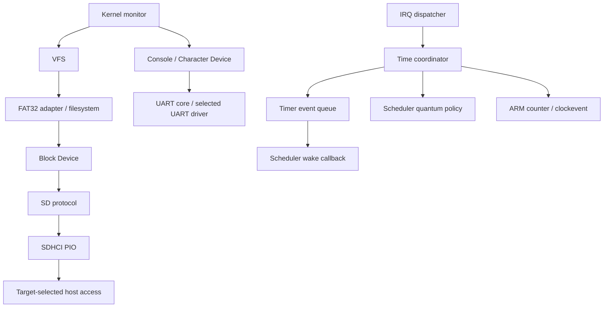

# Enhanced KITOS Phase 0

## 調査と実装計画 (2026-10-27)

変更前は単一Makefileが全ドライバと組込みアプリをリンク。TARGETは画像名、実機/QEMUソース選択なし。
start.Sはcore 0でEL2→EL1、0x80000から起動。例外の汎用レジスタ保存とGIC EOI後の切替は維持する。
同期例外は空処理で同じ命令へ復帰していた。PL011のRX IRQが未実装、登録はmini UART固定。
タスクは8枠とidle、RR。task.cが8個のアプリ関数とリンカ固定スタックを認識していた。
イベントはIRQ回数で期限を計算し、arch timerがイベントとGICとスケジューリング要求を兼務。
block.cはSD実装を直接登録。SDプロトコル/SDHCIは既に分離されるが同時に2ホストを試行し、固定LBAにマウント。
FAT32は512バイト、MBR/直接ボリューム、LFN/UTF-8、全体置換書込み、mkdirを実装。
VFS、offset I/O、truncate、rename、rmdirがない。呼出し側直列化が必要。
GPIO APIはbackendへ直接依存。printkの共有バッファはプリエンプションで破壊され得る。
空のmm/syscallなどを実装済み扱いしない。MMU/EL0/ELFはPhase 1以降。

段階:
1. P0-A/E: ターゲット別ビルド、アプリ非依存スタック、旧ソース保管、モニタと回帰タスク。
2. P0-B: board初期化、char/console、GPIO、block登録API。
3. P0-C: clock/event/IRQ/scheduler分離、SDプロトコル/host/board別MMIO、時間ベースtimeout。
4. P0-D: 明示的な寿命と直列化を持つVFS、FAT32のファイル/ディレクトリ操作拡充。
5. 専用イメージだけでhost/QEMU試験、両ターゲット警告なしビルド、設計・制約の記録。

## 調査資料

- [QEMU v10.2.0 BCM2838](https://github.com/qemu/qemu/blob/v10.2.0/hw/arm/bcm2838_peripherals.c): eMMC2と従来SDHCIは別インスタンス。GPIOのSDバスは従来SDHCI/SDHOSTを参照。
- [Linux v6.12 SDHCI iProc](https://github.com/torvalds/linux/blob/v6.12/drivers/mmc/host/sdhci-iproc.c): BCM2711の32bitアクセス、transfer/command同時書込み、低速時の書込み間隔。
- [Firmware mailbox property interface](https://github.com/raspberrypi/firmware/wiki/Mailbox-property-interface): clock取得/設定、応答buffer、channel 8。
- [BCM2711 peripherals](https://datasheets.raspberrypi.com/bcm2711/bcm2711-peripherals.pdf): GPIO、UART、MMIO。

実機はビルドとQEMU試験では保証できない。実機動作確認は別途必要。

## 完成した構造と依存方向

```text
arch/arm64/boot/       start.S: core 0、EL2→EL1、既存ロード位置
arch/arm64/kernel/     例外、コンテキスト、Generic Timer、MMIO
platform/rpi4/common/  GICv2 と irq_controller API
platform/rpi4/hardware/ PL011/eMMC2選択、firmware clock、32bit SDHCI access
platform/rpi4/qemu/    mini UART/従来SDHCI選択、native-width SDHCI access
kernel/init/          初期化順序・VFSルートマウント
kernel/console/       Character Deviceに接続するコンソール
kernel/monitor/       EL1診断・ファイル操作
kernel/sched/         タスク寿命、RR、sleep、IRQ後切替
kernel/time/          単調クロック、期限イベント、clockeventの調停
kernel/irq/           ハンドラ登録・dispatch・EOI後のスケジューリング
kernel/sync/          非待機gateとタスク資源pin
kernel/printk/        呼出しごとの書式バッファ
drivers/block/       汎用登録・範囲検査・block I/O
drivers/char/        UART→Character Device adapter
drivers/uart/        共通RXリングとPL011/mini UART
drivers/gpio/        共通APIとBCM2711 backend
drivers/mmc/         SDプロトコル、SDHCI PIO
drivers/mailbox/     実機初期化用のclock property要求
fs/vfs/               type/mount/super_block/inode/file、パス・寿命・直列化
fs/fat32/             FAT32本体とVFS adapter
include/              公開契約。タスク内部構造はtask.c内のみ
lib/                  freestanding memory/string、Unicode/CP437
linker/               RX/R/RW分離、カーネル境界・BSS・ブートスタック
usr/legacy/           旧アプリと旧仕様の参照資料（非ビルド対象）
tests/ tools/         host tests、専用イメージ生成、QEMU回帰
```



ブート方式・ロード位置・EL1実行は維持。EL2からの物理カウンタ/タイマーアクセス許可を明示。
リンカのアプリ専用0x800000〜固定領域を現行イメージから除去。
通常タスク8枠とidleには各64 KiBの静的スタックを割り当てます。
FSの4096-byteセクタ・LFN・VFSパス処理の最大呼出し深さを考慮したサイズです。
`__kernel_start`/`__kernel_end`はPhase 1の予約領域として利用できます。

## 主要API

| API | 責務・寿命 |
| --- | --- |
| `platform_init/platform_uart/platform_storage` | Makefileが選択したboardを初期化。デバイスは静的寿命 |
| `block_register/block_init/block_read/block_write` | 名前、block size/count、ops/context。範囲と加算overflowを検査。FATはこのAPIのみ使用 |
| `char_device`, `console_bind/try_getc/write` | UARTハードウェアと端末改行処理を分離。入力は非待機 |
| `uart_register`, `uart_try_getc`, `uart_get_rx_stats` | RXリング・欠落通知。PL011/miniとも1 IRQあたり最大64文字 |
| `gpio_init/read/write/pinMode/set_pull/set_function` | backend opsを選択。pinmuxとpullのレジスタ操作をGPIOへ集約 |
| `clock_now/frequency/ms/after_ms` | 割込み配信に依存しない時刻 |
| `kernel_timer_arm/arm_at/cancel/pending` | 呼出し元所有イベント。登録解除または発火まで寿命を保持 |
| `irq_register`, `irq_controller_*` | ハンドラとコントローラを分離。無効IRQを抑止 |
| `task_create/sleep_ms/control` | アプリ名やリンク先に依存しないカーネルタスク |
| `vfs_register/mount/unmount` | 最大4 type/4 mount。filesystem側のsuperblockを保持 |
| `vfs_open/close/read/write/seek/ftruncate` | 最大16 file。`file*`はcloseまでのみ有効。fd/syscall ABIではない |
| `vfs_stat/list/mkdir/unlink/rmdir/rename` | backend相対パスへ解決。root/子mount保護、cross-mount rename拒否 |
| `fat32_pread/pwrite/truncate/rmdir/rename/set_attributes/set_times/free_space` | 追加したFAT32操作。offsetはbyte、最大ファイルサイズはFATの32bit上限 |

VFS・新しいAPIは成功0、失敗は`kernel/error.h`の負数。read/writeの転送量は別引数。
FAT内部のディレクトリ探索にだけ「未発見=1」があり、公開`fat32_stat`は`-K_ENOENT`へ変換します。
既存GPIO/タスクAPIの負数は一部従来値を保持します。これらは安定したEL0 ABIではありません。

## タイマーとスケジューラ

- `arch/arm64/kernel/timer.c`はCNTFRQ/CNTPCT読取りとCNTP_CVAL設定のみ。GIC、printk、task、イベントを参照しません。
- `clock.c`で単調クロックを公開。ms変換は乗算overflowを避け、sleep期限はcounter cyclesで保持。
- `timer.c`は期限順の呼出し元所有リスト。IRQ save/restoreで挿入・取消・期限処理を直列化。
- 同一期限は登録順。callback前にイベントを外し、callbackからの再登録・他イベント取消を可能にしています。
- callbackはIRQ禁止、待機・ログ出力・切替禁止。1 IRQの期限処理は最大32件で残りは次の割込みへ。
- `time.c`がイベント最短期限と10ms quantumを比較し、one-shot comparatorを設定します。
  遅延IRQで時刻が遅れず、過去の期限を大量に追いかけません。
- wake callbackはタスクをREADYへ戻すのみ。スケジューラのquantum判断とGIC EOIの後に切替。
- 現在はsingle core、最大10msのRR quantumを維持。完全なidle tickless・SMP・任意の長時間callback実行は未実装です。
- `printk`はスタック上のバッファへ整形し、通常IRQでは呼びません。複数タスクの出力行の原子的な結合は保証しません。

## SD、SDHCI、実機/QEMU

| 項目 | QEMU | 実機 |
| --- | --- | --- |
| UART | mini UART、GIC ID 125 | PL011、GIC ID 153、mailboxで48MHz |
| SD host | 従来SDHCI `0xFE300000` | eMMC2 `0xFE340000` |
| レジスタaccess | QEMU generic modelの8/16/32bit | 32bitのみ、8/16bit controlをRMW |
| コマンド発行 | CMDTM 32bit同時書込み | CMDTM 32bit同時書込み、低速clock-domain間隔 |
| 基準クロック | capability register | firmware mailbox clock ID 12 |
| カード配線 | QEMUのSDバスモデル | firmwareがSDブート用に設定したeMMC2 routingを使用 |

SD層はCMD0/8/55/ACMD41/2/3/9/7/16、CSD容量、SDSC byte addressingとSDHC block addressingを担当。
CMD8 timeoutの旧SDカードも扱い、ACMD41は2秒で打ち切ります。通常host待機は1秒。
SDHCI層はinhibit、clock divider、response、PIO FIFO、completion、command/data resetを担当。
SDHCI v2の2冪dividerとv3の偶数dividerを区別します。
現在の転送はCMD17/24で1 blockずつ。読み込みはreset後に1回再試行、成否不明の書込みは再試行しません。
PIO APIは複数block要求を拒否し、未実装のCMD12を必要とする転送を許可しません。
MMCプロトコル、SDIO、DMA、UHS、4-bit busの高速化は追加していません。
「eMMC2」はhost名であり、eMMC媒体のMMCプロトコル実装済みという意味ではありません。

## FAT32とVFSの対応範囲

FAT32は512/1024/2048/4096-byte論理セクタを512-byte Block Device上へ変換します。
BPB geometry、FAT容量、cluster範囲、MBR extent、overflowを検査。
複数FATのmirroringと、mirror無効時のactive FAT選択を実装し、FSInfoとそのbackupのヒントを更新します。
空き容量はFATを走査して取得できます。破損したchainは有限の走査で失敗し、chain長確認ではcycleを早期検出します。

通常ファイルの作成、全体置換、部分I/O、append、seek、truncate/zero extension、削除、
階層ディレクトリ作成・一覧・空directory削除、file/directory rename/moveを利用できます。
255 UTF-16 code unitsのVFAT LFN、surrogate pair、UTF-8変換、short alias collisionと削除を扱います。
8.3の既定OEMはCP437。Unicodeの1文字uppercase mappingでcase-insensitive lookupを行います。
大文字化が複数文字になる変換やUnicode正規化はしません。別OEM codepageの媒体は現時点で対象外です。
attributesとFAT日時の読取り/明示設定ができます。RTC未導入のため新規entryは1980-01-01を使い、自動の実時刻更新は行いません。
volume labelは保持して一覧から除外しますが、label変更・format・fsckはホストツールの責務です。
FAT12/16、exFAT、GPT、MBR拡張partitionの探索は対象外です。

VFSは絶対パスをcomponent単位で確認し、`.`/`..`、重複slash、trailing slash、長さを処理。
`/missing/..`と`/file/..`を成功扱いしません。最長一致のmountを選択します。
fileはinodeの属性snapshot・backend相対path・position・modeを持ち、I/O前に再lookupするため別handleの変更を反映します。
namespaceの変更は同じmountにopen fileがある間は`-K_EBUSY`とします。open-unlinkなどPOSIX寿命方式は未実装。
renameはcase-only変更と同種destinationの置換に対応します。置換先directoryは空である必要があります。

動的確保はありません。mount/file/FATインスタンスは固定pool、close/unmountで再利用します。
VFSのgateはIRQを止めたままSD完了を待ちません。競合/再入時は`-K_EBUSY`を返し、callbackからのVFS再入も拒否。
gate所有タスクのresource pinによりstop/kill/外部sleepを拒否し、資源を残した強制終了を防ぎます。
直接のFAT/Block API利用者には外部直列化が必要です。IRQからのFS操作は契約外です。

FAT32はjournalを持たず、電源断時のatomic性は保証しません。
置換書込みは新chainを作成してから公開し、元chainを最後に解放。
容量不足なら元データを保持。truncateは短いsizeを先に公開し、参照されるclusterを先に解放しません。
media write errorは成否不明なので、そのmountの以後の書込みを停止します。
その場合や電源断ではlost clusterや二重名が残り得るため、外部fsck後に再mountします。

## 旧モジュールの扱い

BASIC、editor、demo_a〜d、GPIOアプリ、旧shell/runtime/headers、旧README/linkerを`usr/legacy/`へ移動。
通常ビルドから除外しましたが、ソースを保持しています。
個別アプリへの依存はtask.c・現行linker・起動処理から除去しました。
旧デモ専用のworkカウンタ・色指定・message queueも現行task APIから除き、診断はsnapshot/monitorで行います。
空だったcpu/platform/systemcall/fs header/errno/compiler/mailbox/mkfsのplaceholderは削除。
実装のあるカーネル機能を恒久削除していません。

## 検証

実行環境: macOS、AArch64 GNU bare-metal GCC 15.2.0、QEMU 10.2.2 (`raspi4b`)。

| 項目 | 結果 |
| --- | --- |
| `make PLATFORM=rpi4 TARGET=qemu -j4` | 成功、`-Wall -Wextra -Werror` |
| `make PLATFORM=rpi4 TARGET=hardware -j4` | 成功、同条件。実機動作試験ではない |
| Block既存試験 | LBA read/write・境界検査PASS |
| FAT32既存試験 | direct/MBR、8.3/LFN、置換/伸縮、FAT mirror/FSInfo PASS |
| VFS/FAT32拡張試験 | 7321 checks × 4 sector sizes PASS、ASan/UBSan |
| Timer host試験 | 79 checks PASS: 期限順・取消・再登録・遅延・IRQ budget・counter wrap |
| SDHCI hardware accessor試験 | 1873 checks PASS: 32bit MMIO、PIO、divider、error/reset、timeout（mock） |
| SD protocol試験 | 1031 checks PASS: v1/v2、CSD、byte/block address、retry/write不再試行、timeout（mock） |
| QEMU起動・UART入出力 | PASS、SD媒体なしでもモニタ起動を確認 |
| QEMU IRQ・preemption・sleep | PASS。yieldしない2 workerが両方進行 |
| QEMU stop/resume/cancel/kill/reuse/pin | PASS、selftestを繰り返し実行 |
| QEMU SD/FAT32/VFS | 作成・追記・truncate・move・削除・再起動永続性PASS |
| 外部互換性 | mcopyでQEMU出力を読取り、FAT checkerで整合性検査PASS |
| Clang static analyzer | FAT32/VFSで警告なし |
| GPIO | 両target build、QEMUコマンド実行PASS。電気的入出力は未検証 |

`tools/test_images.py`と`tools/qemu_test.py`が専用媒体を生成。元の128GiB `image/arm64/sd.img`は開いていません。
`build/tests/qemu-transcript.txt`にQEMUの操作ログを保存します。
検証中のhost側heap allocationはテストのfixture保存にのみ使い、カーネルには導入していません。

## 未検証事項とPhase 1への引継ぎ

1. 実機でPL011 RX IRQ・mailbox clock・eMMC2初期化/PIO・GPIO pull/入出力を確認する。
   hardware accessorのmock試験は実機信号・電源・firmware routingの検証を代替しません。
2. 実際のカードの抜差し、電源断、途中sector破損、firmware版の差を追加試験する。
3. VFSの固定pool/非待機gate/namespace制限を、allocator・待機mutex・inode cacheを導入するときに置換する。
4. Phase 1ではboot memory/DTB情報を取得し、`__kernel_*`、firmware予約、task stacks、mailbox bufferを物理allocatorから除外する。
5. MMU導入時はboard/driverのMMIO baseをDevice属性のmappingへ変更。mailbox bufferのCPU/GPUアドレス変換とcache保守を追加する。
6. SMP導入時は現在のsingle-core IRQ保護をper-CPUとspinlockへ拡張し、task/context/IRQ stackを見直す。
7. EL0・SVC・ユーザーポインタ検査・fd table・ELF64/Newlibは本VFS APIと分離して実装する。
8. FAT32の電源断耐性、RTCによる時刻更新、追加OEM codepage、POSIX風open-unlinkは残る拡張点。

